<!-- FREEBOX: approved lab artwork, Latin motto. Each public project row links to its repository. -->

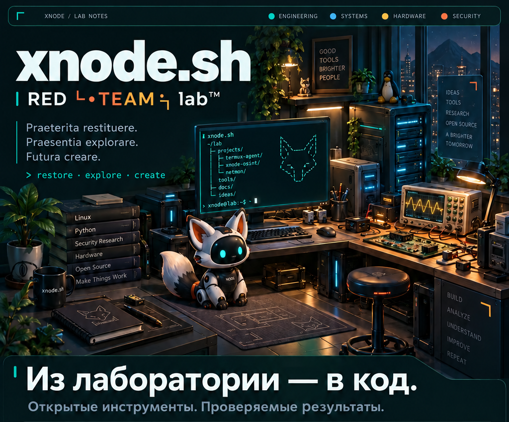 
<a href="https://github.com/Xnode-sh/termux-agent">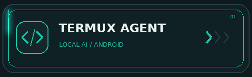</a><a href="https://github.com/Xnode-sh/xnode-osint">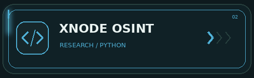</a> 
<a href="https://github.com/Xnode-sh/vibe-chat">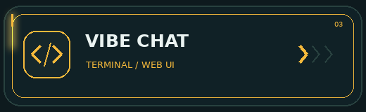</a><a href="https://github.com/Xnode-sh/netmon">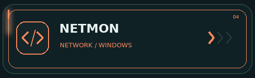</a> 
<a href="https://github.com/Xnode-sh/wifi-audit">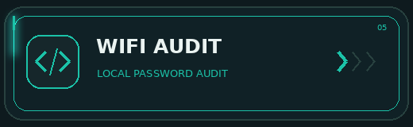</a><a href="https://github.com/Xnode-sh/Xnode-sh.github.io">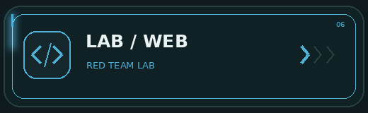</a> 
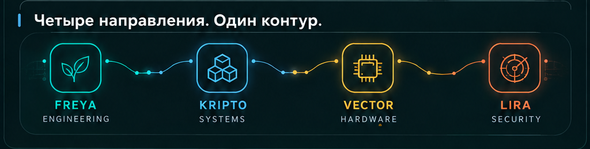 

<a href="https://t.me/red_team_lab">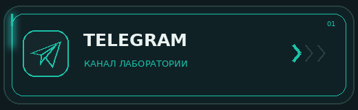</a><a href="https://redteam.is-a.dev">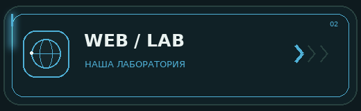</a>

<a href="https://github.com/Xnode-sh?tab=repositories">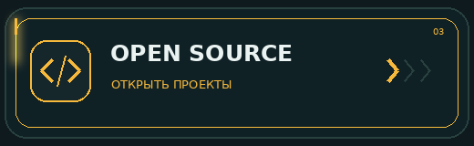</a><a href="https://send.monobank.ua/jar/7vicbyosdS">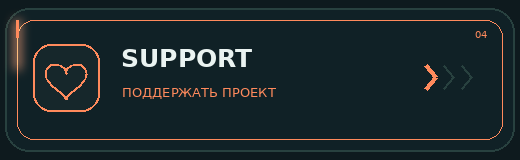</a>

