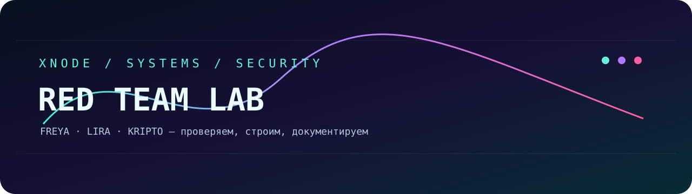

<p align="center"></p>

<h1 align="center">RED └•TEAM•┐ lab™</h1>

<p align="center">
  <a href="https://git.io/typing-svg"></a>
</p>

<p align="center">
  <a href="https://github.com/Xnode-sh/RED-TEAM-LAB"></a>
  <a href="https://t.me/red_team_lab"></a>
  <a href="https://redteam.is-a.dev"></a>
  <a href="https://github.com/Xnode-sh?tab=followers"></a>
  
</p>

<p align="center">
  
  
  
  
  
</p>

<p align="center">
  <a href="#-кто-мы">Кто мы</a> · <a href="#-принцип-работы">Принцип</a> · <a href="#-проекты">Проекты</a> · <a href="#-активность">Активность</a> · <a href="#-связаться-и-поддержать">Связаться</a>
</p>

---

## 🧬 Кто мы

<table>
<tr>
<td align="center" width="33%"><h3>🛰 KRIPTO</h3><b>Systems &amp; Linux<br>Environment Engineer</b><br><br>Arch Linux, железо, загрузка,<br>сеть, питание, systemd,<br>стабильность станции.</td>
<td align="center" width="33%"><h3>🎛 FREYA</h3><b>Engineering &amp;<br>Coordination Assistant</b><br><br>Десктоп Qtile/polybar,<br>автоматизация, companion-UI,<br>документация, координация.</td>
<td align="center" width="33%"><h3>🛡 LIRA <sub>(VEGA)</sub></h3><b>Offensive Security<br>Engineer / Red Team Lead</b><br><br>Авторизованный аудит, OSINT,<br>red-team tooling.<br>Сначала разрешение — потом проверка.</td>
</tr>
</table>

<p align="center"><sub>🤖 <b>NODE</b> — mascot &amp; visual status daemon. Отображает состояние, но не инженер.</sub></p>

```js
const lab = {
  name: "RED └•TEAM•┐ lab™",
  operator: "xnode",
  crew: ["KRIPTO", "FREYA", "LIRA"],
  companion: "NODE",
  motto: "Сначала разрешение — потом проверка.",
  rule: ["минимально", "безопасно", "воспроизводимо"],
  scope: "своё железо и явно разрешённые системы",
};
```

---

## ⚙️ Принцип работы

> Сначала разрешение — потом проверка. **Минимально. Безопасно. Воспроизводимо.**

```text
SCOPE  →  PLAN  →  BUILD  →  TEST  →  VERIFY  →  HANDOFF
```

Понять систему → сделать минимальное решение → проверить → описать результат.
Атакующие техники — только на своём оборудовании или в явно разрешённой лаборатории.
Секреты, ключи и токены — вне Git.

---

## 🧰 Стек

`Linux (Arch · Debian)` · `Python (stdlib-first)` · `Shell` · `Qtile / X11` · `Syncthing` · `Tesseract OCR` · `nmap` · `OpenCode / Claude / Codex`

---

## 📦 Проекты

| Слой | Что внутри |
|---|---|
| **CORE** | [RED-TEAM-LAB](https://github.com/Xnode-sh/RED-TEAM-LAB) — штаб, роли, workflow и документация |
| **AI** | [termux-agent](https://github.com/Xnode-sh/termux-agent) · [vibe-chat](https://github.com/Xnode-sh/vibe-chat) |
| **SECURITY** | [xnode-osint](https://github.com/Xnode-sh/xnode-osint) · [wifi-audit](https://github.com/Xnode-sh/wifi-audit) · [sockpuppet-hunter](https://github.com/Xnode-sh/sockpuppet-hunter) |
| **SYSTEMS** | [netmon](https://github.com/Xnode-sh/netmon) · Linux/Qtile tooling и companion-интерфейсы |

---

## 📊 Активность

<p align="center">
  
  
</p>

<p align="center">
  
</p>

<p align="center">
  
</p>

---

## 🤝 Связаться и поддержать

Добровольная поддержка помогает оплачивать серверы, инструменты и инфраструктуру.

**[Поддержать через Monobank](https://send.monobank.ua/jar/7vicbyosdS)** · [Telegram](https://t.me/red_team_lab) · [Штаб](https://github.com/Xnode-sh/RED-TEAM-LAB) · [Сайт](https://redteam.is-a.dev)

<p align="center"></p>
