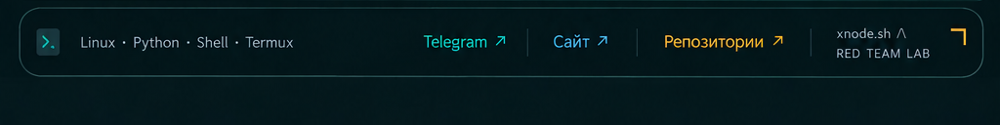

<!-- FREEBOX: approved lab artwork, Latin motto. Each public project row links to its repository. -->

 
 
 
 
 

<a href="https://t.me/red_team_lab">Telegram ↗</a> &nbsp; · &nbsp;
<a href="https://redteam.is-a.dev">Сайт ↗</a> &nbsp; · &nbsp;
<a href="https://github.com/Xnode-sh?tab=repositories">Репозитории ↗</a> &nbsp; · &nbsp;
<a href="https://send.monobank.ua/jar/7vicbyosdS">Поддержать лабораторию ↗</a>

Лаборатория, проекты и команда — текстовая версия

## RED └•TEAM•┐ lab™ · xnode.sh

**Praeterita restituere. Praesentia explorare. Futura creare.**

Прошлое — восстановить. Настоящее — исследовать. Будущее — создавать.

### Из лаборатории — в код

| Проект | Назначение | Среда |
| --- | --- | --- |
| [termux-agent](https://github.com/Xnode-sh/termux-agent) | Локальный LLM-агент с вызовом инструментов | Android · Termux / proot · Python |
| [xnode-osint](https://github.com/Xnode-sh/xnode-osint) | OSINT-инструменты и HTML-отчёты | Python · CLI |
| [netmon](https://github.com/Xnode-sh/netmon) | Мониторинг локальной сети, DNS и захват трафика | Windows · Python · CLI |

Другие открытые разработки: [vibe-chat](https://github.com/Xnode-sh/vibe-chat) · [wifi-audit](https://github.com/Xnode-sh/wifi-audit) · [sockpuppet-hunter](https://github.com/Xnode-sh/sockpuppet-hunter).

### Четыре направления. Один контур.

| Участник | Направление |
| --- | --- |
| FREYA | Engineering & Coordination — Qtile/polybar, автоматизация, companion-UI, документация |
| KRIPTO | Systems & Linux — загрузка, сеть, питание, systemd, стабильность станции |
| VECTOR | Hardware & Firmware — платы, микроконтроллеры, прошивки, аппаратная диагностика |
| LIRA (VEGA) | Security — авторизованный аудит, OSINT, red-team tooling |

**NODE** — mascot & visual status daemon: отображает состояние лаборатории.

### Принцип работы

Сначала разрешение — потом проверка. **Минимально. Безопасно. Воспроизводимо.**

Понять систему → сделать минимальное решение → проверить → описать результат.
Атакующие техники — только на своём оборудовании или в явно разрешённой лаборатории.
Секреты, ключи и токены — вне Git.

### Стек и активность

Linux (Arch · Debian) · Python (stdlib-first) · Shell · Qtile / X11 · Syncthing · Tesseract OCR · nmap · OpenCode / Codex / Antigravity.

[Коммиты и вклад](https://github.com/Xnode-sh?tab=overview) · [Репозитории](https://github.com/Xnode-sh?tab=repositories) · [Публикации лаборатории](https://t.me/red_team_lab).

Добровольная [поддержка через Monobank](https://send.monobank.ua/jar/7vicbyosdS) помогает оплачивать серверы, инструменты и инфраструктуру.

